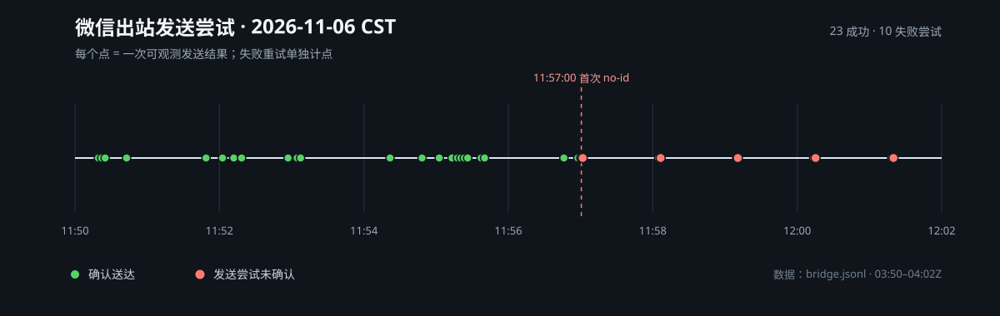

# 2026-11-06 微信出站静默失败事件

## 结论

2026-11-06 11:49 CST（03:49Z）大号刚恢复后，到 12:01 CST（04:01Z）再次出现
`WeChatNotAcknowledged`。日志只能证明微信 API 没有返回消息 ID，无法区分临时限流、账号限制
或内容过滤；不能把“封禁”写成已证实结论。

**当前怀疑**：`WeChatNotAcknowledged` 可能是账号开始静默限制/静默丢弃阶段的首个可观测标志。
目前只能称为怀疑：单次出现不足以证明封禁，也可能是单条过滤、接口异常或响应变化；本事件中
随后正文和 completion 同时持续无 ID，才使它更像账号级静默限制。

这不是服务未启动或模板未生成的单一故障。窗口内服务日志仍有 `bridge.start`、认证有效、
入站可读；失败集中在出站投递。最可疑的因素是短时间出站消息密度：约 12 分钟内产生 39 个
出站片段，其中 23 个成功送达，之后连续被静默丢弃。

## 时间线（CST / UTC）

| 时间 | 事件 |
|---|---|
| 11:49 / 03:49 | 大号解封，`/s` 等开始可正常收发 |
| 11:50:18 / 03:50:18 | 安装更新后桥接启动；重启补发了 3 条积压正文 |
| 11:50:19 / 03:50:19 | `/status`，随后服务重启；约 1 分钟内 4 个出站片段 |
| 11:51–11:52 / 03:51–03:52 | `/sessions`、`/backend`、`/sessions`、`/switch` 连续执行 |
| 11:53–11:56 / 03:53–03:56 | 多个正文和多段回复；11:55 前后的 `/queue` 一分钟内产生 8 个出站片段 |
| 11:56:57 / 03:56:57 | 正文分 2 段，前一段成功 |
| 11:57:00 / 03:57:00 | finish completion 第一次 `WeChatNotAcknowledged`；随后正文开始连续失败 |
| 11:58–12:01 / 03:58–04:01 | 继续有回复和重试；失败后发送暂停 60 秒 |
| 11:59:10 / 03:59:10 | 第二次安装更新/服务重启；重试了积压消息，但不是首次失败的原因 |

## 统计

- 入站消息：11 条，其中控制命令 6 条：`/status`、`/sessions` 两次、`/backend`、`/switch`、`/queue`
- 出站片段：39 个，23 个成功，之后出现 10 次 `WeChatNotAcknowledged` 尝试
- 最后成功：11:56:57 的正文第一段
- 首次失败：11:57:00 的 `role=completion`
- 服务在 11:50:18、11:50:42、11:59:10 重启；前两次在首次失败前，最后一次在失败后
- 当前状态：认证仍为 `valid`，服务仍为 `active`，但发件箱有未确认消息

## 频率

- 观测窗：03:50:18.939Z–04:01:27.430Z，约 11 分 08 秒
- 总量：39 个出站片段、33 个输出组、11 条入站；39 个片段不是 39 个逻辑回合
- 首次失败前：23 个片段成功，跨度 03:50:19.428Z–03:56:57.839Z（约 6 分 38 秒），
  平均约 3.46 个片段/分钟，约每 17.3 秒一个
- 任意滑动 60 秒内最多成功 9 个片段（03:54:48–03:55:40）；其中 03:55 这一分钟成功 8 个
- 最密的一小段为 03:55:02–03:55:40：38 秒内 8 个出站片段，约 12.8 个片段/分钟
- 成功发送间隔：最短 2.8 秒、中位数 10.0 秒、最长 74.4 秒
- 首次失败后：其余片段继续入队；10 次 `WeChatNotAcknowledged` 重试尝试，最终 5 个条目失败、
  11 个仍留在发件箱/未确认（以当时快照计）

11:54–11:56 的成功发送间隔（CST，按相邻成功发送计算）：

| 成功时间 | 与上一次间隔 |
|---|---:|
| 11:54:21.779 | — |
| 11:54:48.350 | 26.571s |
| 11:55:02.615 | 14.265s |
| 11:55:13.290 | 10.675s |
| 11:55:17.792 | 4.502s |
| 11:55:20.604 | 2.812s |
| 11:55:23.416 | 2.812s |
| 11:55:26.228 | 2.812s |
| 11:55:37.424 | 11.196s |
| 11:55:40.248 | 2.824s |
| 11:56:46.185 | 65.937s |
| 11:56:57.839 | 11.654s |

其中 2.8 秒左右的连续段分别对应：

- 11:55:17.792：上一条 Agent 回答的正文第一段
- 11:55:20.604：该回答的 finish completion
- 11:55:23.416：`/queue` 的“已排队”确认
- 11:55:26.228：排队消息的处理回执（ack）
- 11:55:37.424：排队任务回答的正文
- 11:55:40.248：该回答的 finish completion

首次 no-id 前后的实际发送点（CST，正文不落入档案）：

| 时间 | 与上一次间隔 | 角色 | 结果 |
|---|---:|---|---|
| 11:56:46.185 | 65.937s | 即时 ack（`role=body`） | 成功 |
| 11:56:57.839 | 11.654s | 正文 | 成功 |
| 11:57:00.619 | 2.780s | finish completion | no-id，尝试 1 |
| 11:57:01.851 | 1.232s | 同一 finish | no-id，尝试 2 |
| 11:57:05.039 | 3.188s | 同一 finish | 重试耗尽，暂停 60s |
| 11:58:05.267 | 60.228s | 积压 ack（`role=body`） | no-id，尝试 1 |
| 11:58:06.539 | 1.272s | 同一 ack | no-id，尝试 2 |
| 11:58:09.781 | 3.242s | 同一 ack | 重试耗尽，再次暂停 |

11:57:05.039 和 11:58:09.781 只有 `output.failed`，没有额外的
`output.send_failed`；它们是第三次尝试后的重试耗尽点，不是新的消息。11:58:05
的 ack 是 60 秒暂停后的积压发送，不是正常即时 ack。

## 可疑操作与已排除项

- **可疑**：短时间大量控制命令、多段正文、每轮额外的 finish completion，以及重启后补发积压。
  其中 finish 是 11:57:00 第一个失败的角色，但正文随后也全部失败，因此不能证明 finish
  单独导致限制。
- **重复内容假设**：首次失败前存在少量完全相同的桥接消息：11:44:36/39/44 三次
  “已恢复会话”、11:44:47/48 两次相同状态、11:50:22/42 两次“已恢复会话”。但首次
  no-id 之前没有 no-id 重试；finish 和 ack 的各三次重试都发生在首次失败之后。因此
  重复内容可能是账号限制的加重因素，当前证据不足以把它认定为初始触发原因。首次
  no-id 后的重试还可能让微信侧看到重复内容，而桥接因为拿不到 ID 无法确认第一次是否
  实际投递。
- **已排除为直接原因**：认证失效、服务未启动、模板缺失。日志显示认证有效、服务启动、
  completion 已入队并实际发起了发送。
- **内容审核假设**：首次失败的是 finish 指标行，不是正文重发；此前 2.78 秒的正文
  已拿到消息 ID。若该正文被事后审核并触发账号级限制，可以解释后续全部 no-id；但
  没有任何审核通知，且之后不同内容的 ack、正文也全部失败。因此“单条内容被拦”本身
  不足以解释全部现象，除非它升级成了账号级限制。当前无法证实。
- **不能证实**：具体服务端阈值、内容过滤原因、账号限制的具体持续时间。
- **已确认的无关测试缺陷**：早期 `uninstall` 测试隔离不完整，曾误删真实 `.data-root`；
  已在 2026-11-06 修复，和本次微信出站静默失败不是同一故障。

## 后续排查

1. 继续保留 `bridge.jsonl` 的原始窗口，不要只依赖成功/失败计数。
2. 比较恢复后到首次失败之间的出站片段数、分段数、命令数和完成提示次数。
3. 若再次遇到，先停止重试/重绑并等待，避免用密集扫码或重复发送加重限制。
4. 复现时记录账号、bot 标识、恢复时间、首次失败时间和每次发送的 API 回执，但不要把
   正文、token 或完整 URL 写入仓库。
5. 2026-11-06 后续代码已改为：首次 `no-id` 即隔离为 `delivery_unknown`、暂停出站并
   不自动重发；本档案保留事故当时的旧重试时间线，用于对照。

脱敏关键事件见 [events.jsonl](2026-11-06-wechat-silent-drop.events.jsonl)。完整原始日志仍在
运行机 `logs/bridge.jsonl`，可能随轮转清理；本文件只保留事件元数据，不含消息正文。
